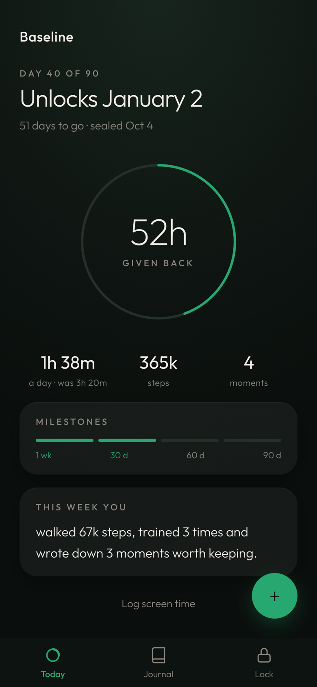
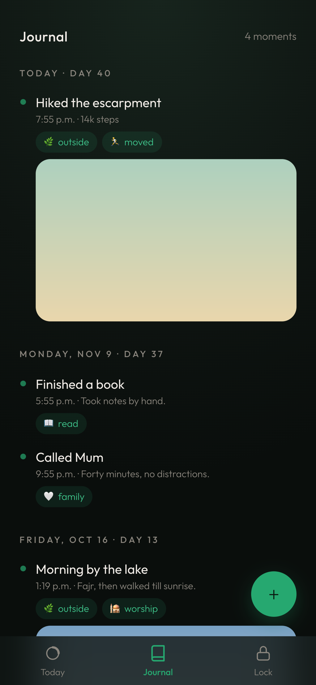
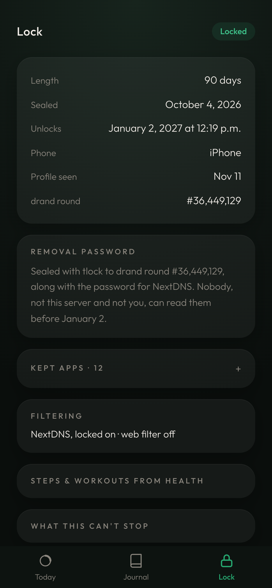
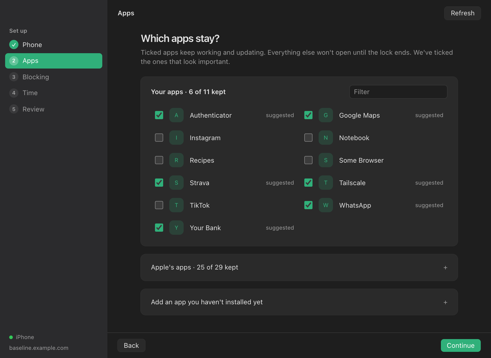
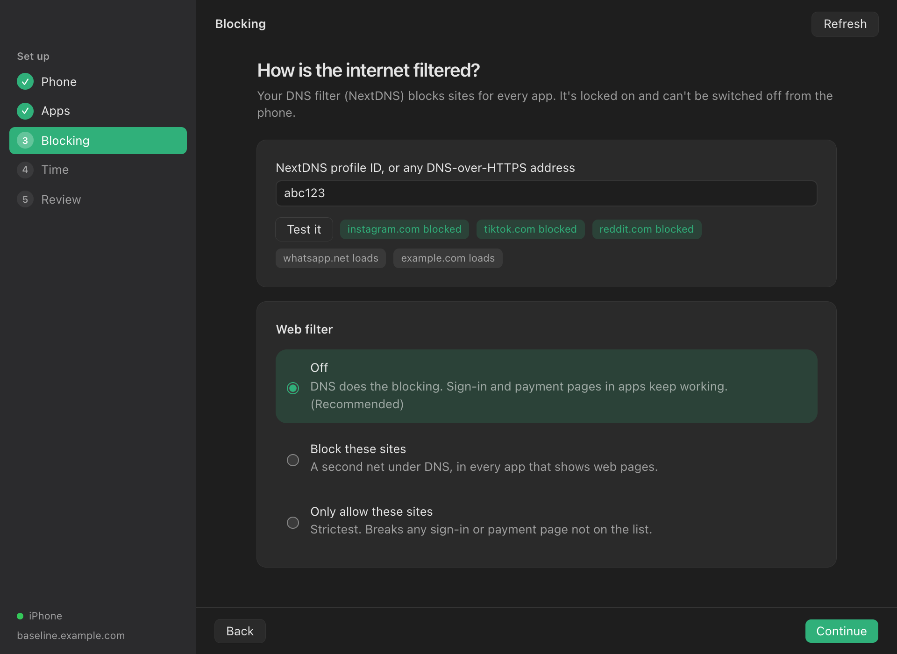
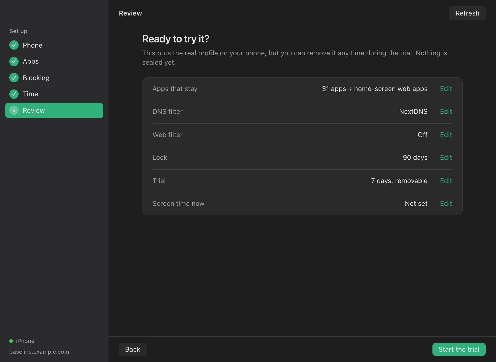

<p align="center">
  
</p>

<h1 align="center">Baseline</h1>

<p align="center">
  A 90-day lock for your iPhone that even you can't open early.<br />
  Keep the apps you need, block the rest, and see what you did with the time.
</p>

<p align="center">
  
  &nbsp;
  
  &nbsp;
  
</p>

## What it does

Baseline puts a configuration profile on a **supervised** iPhone that:

- **Keeps only the apps you choose.** Banking, Wallet, Health, work apps and messaging keep
  working and updating. Everything else, including new installs, won't open.
- **Filters the internet with DNS.** Usually NextDNS, locked on so it can't be switched off from
  the phone. An optional web filter can block (or only allow) specific sites as well.
- **Can't be removed until the date.** The profile's removal password is made at random and
  [time-locked with tlock](https://github.com/drand/tlock) to a future round of drand's public
  randomness beacon. Nobody can decrypt it before then: not the server, and not you.

You live with it as a removable **trial** for up to 7 days first. When everything you need
works, you **seal** it for 90 days or more. Sealing can also lock the passwords of accounts that
could undo the lock (your NextDNS account and its email): Baseline makes new ones, you paste them
into the sites, and they unlock on the same day as the profile.

## The three parts

| | What it is | What it does |
|---|---|---|
| **Baseline for Mac** (`mac/`, `electron/`) | A Mac app (Electron) that talks to the phone over USB through Apple Configurator's `cfgutil` | Reads your phone's apps by name and icon, walks you through setup step by step, installs the trial, seals it, and removes it when the lock opens |
| **Status app** (`pwa/`) | A home-screen web app on the phone | **Today:** day count, hours given back, steps, milestones. **Journal:** moments with notes, tags and photos. **Lock:** dates, what's kept, filtering, and the passwords on unlock day |
| **Server** (`server/`) | A small Node service in Docker, on your own machine | Stores the lock (only the encrypted passwords), the journal and progress numbers, and serves the status app. Everything except the page itself needs a token |

### Baseline for Mac

<p align="center">
  
</p>

<p align="center">
  
  &nbsp;
  
</p>

Five steps (Phone, Apps, Blocking, Time, Review), always in the sidebar. You never type a bundle
ID: apps come off the phone with their names, and apps you haven't installed yet can be added by
searching the App Store. The Blocking step tests your DNS filter before you rely on it. Slow
phone-side actions show progress and send a notification when they finish.

### Progress, without another app to check

The status app has no feed and doesn't nag you to come back. "Hours given back" compares
your screen time before the lock with a weekly 10-second check-in (iOS doesn't let web apps read
Screen Time). Steps and workouts arrive from a daily iOS Shortcut.

## What it can't stop

Baseline makes getting out slow and deliberate, not impossible:

- A full restore of the phone through recovery mode with a computer.
- The supervision identity on your Mac: Apple Configurator can remove the profile with it.
- Changing your DNS provider's settings from another device, unless that account was locked
  when sealing.

See [docs/design.md](docs/design.md) for the full design and the reasoning behind it.

## Set it up

You need a Mac with Apple Configurator, an iPhone that's already **supervised**, and somewhere to
run the server.

### 1. The server

Every push to `main` builds `ghcr.io/amarzbar/baseline:latest`.

```bash
git clone https://github.com/amarzbar/baseline.git && cd baseline
cp .env.example .env && sed -i "s|^BASELINE_TOKEN=.*|BASELINE_TOKEN=$(openssl rand -base64 32)|" .env
docker compose up -d
# pull new images automatically
(crontab -l; echo "*/5 * * * * $PWD/scripts/auto-update.sh >> $PWD/auto-update.log 2>&1") | crontab -
```

It listens on port 3020. Put it behind your reverse proxy with HTTPS. Mine is Nginx Proxy
Manager on a tailnet-only hostname: a DNS-only record pointing at the machine's Tailscale
address, so the site only answers on the tailnet.

### 2. The Mac app

Needs Node 24 and pnpm.

```bash
pnpm install
pnpm mac --server https://baseline.example.com --token <BASELINE_TOKEN> --save   # once, saves settings
pnpm app:dist          # builds release/mac-arm64/Baseline.app; drag it to Applications
```

Settings live in `~/.config/baseline/config.json` (readable only by you).

**Supervision identity.** Without it, the phone asks for confirmation and `cfgutil` can't install
profiles. Export it from Apple Configurator (Settings → Organizations → Export Supervision
Identity), then convert it to a DER certificate and a DER **PKCS#1** key. cfgutil rejects PKCS#8
with "couldn't create supervision identity":

```bash
openssl pkcs12 -in identity.p12 -nokeys -clcerts | openssl x509 -outform DER -out supervision-cert.der
openssl pkcs12 -in identity.p12 -nocerts -nodes | openssl pkey -outform DER -traditional -out supervision-key.der
pnpm mac --cert supervision-cert.der --key supervision-key.der --save
```

### 3. The phone

Open the server's address in Safari, **Add to Home Screen**, open it from there and paste the
token once. Do this before sealing: Safari can be hidden once the lock is on.

## Develop

```bash
BASELINE_TOKEN=dev-token-0123456789 pnpm server   # API + built status app on :3020
pnpm dev:pwa                                      # status app with hot reload on :5180
pnpm mac --token dev-token-0123456789 --no-open   # Mac companion in a browser tab on :8770
pnpm dev:mac                                      # Mac UI with hot reload on :5181
pnpm app                                          # the Electron app, from source
pnpm test && pnpm typecheck && pnpm build
node scripts/screenshots.ts                       # regenerate the README screenshots (sample data only)
```
